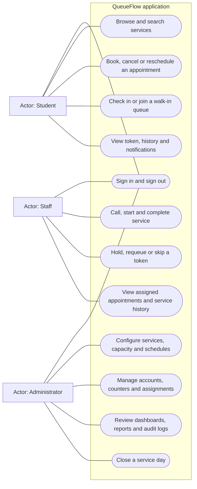
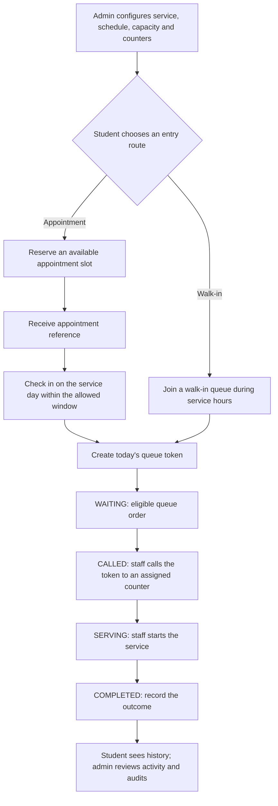
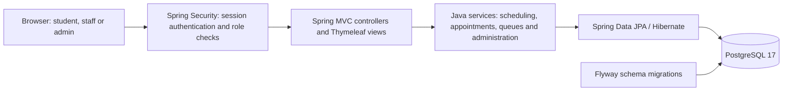
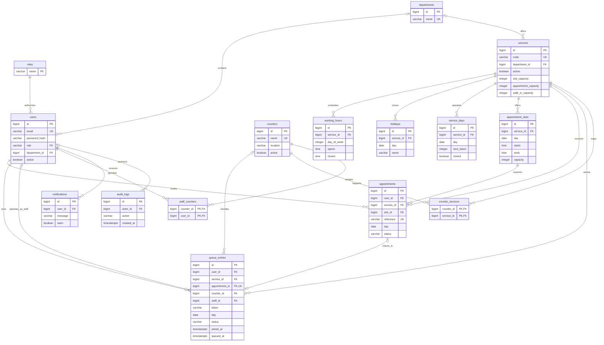

# QueueFlow

### Digital Queue & Appointment Management System

A Java web application for managing college service appointments, walk-in queues and counter operations. QueueFlow connects students, staff and administrators through shared PostgreSQL records, from the initial booking to the completed visit.

[](https://github.com/Shane-06/QueueFlow-Digital-Queue-Appointment-Management-System/actions/workflows/verify.yml)

**Java 21 · Spring Boot 3.5.16 · Thymeleaf · PostgreSQL 17**

> The working application lives in `app/`. Its frontend uses server-rendered Thymeleaf templates. `frontend/` preserves the earlier React prototype as a design reference and is not required to run the Java application.

## Contents

- [Overview](#overview)
- [Features and user roles](#features-and-user-roles)
- [Use-case diagram](#use-case-diagram)
- [Service workflow](#service-workflow)
- [Business rules and lifecycle](#business-rules-and-lifecycle)
- [Architecture and technology](#architecture-and-technology)
- [Database and ER diagram](#database-and-er-diagram)
- [Repository structure](#repository-structure)
- [Getting started](#getting-started)
- [Configuration](#configuration)
- [Demo accounts and walkthrough](#demo-accounts-and-walkthrough)
- [Application routes](#application-routes)
- [Testing and continuous integration](#testing-and-continuous-integration)
- [Security and data handling](#security-and-data-handling)
- [Troubleshooting](#troubleshooting)
- [Current limitations and future scope](#current-limitations-and-future-scope)
- [Project documentation](#project-documentation)
- [Contributing](#contributing)
- [License](#license)

## Overview

College services such as transcript verification and certificate requests involve both advance appointments and students arriving without bookings. Separate appointment lists and physical queues make it difficult to follow a visit, identify the next student or review the final outcome.

QueueFlow provides a common process for these visits:

- Students browse services, reserve an arrival window and track their queue token.
- Staff call eligible tokens at assigned counters and record service progress.
- Administrators configure availability, capacity and assignments, then review activity and audits.

An **appointment reference** identifies a reservation. A **queue token** identifies an active visit after check-in or walk-in entry. Booking a future appointment does not put the student into today's queue.

The project implements a working college demonstration. It does not claim production adoption or measured reductions in waiting time.

## Features and user roles

| Role | Available functionality |
| --- | --- |
| **Student** | Search services, book available slots, cancel or reschedule eligible appointments, check in, join walk-in queues, view token/counter status, visit history and in-app notifications. |
| **Staff** | Select an assigned counter, view relevant appointments and queue entries, call the next eligible token, start or complete service, hold/requeue/skip tokens and review service history. |
| **Administrator** | Manage services, appointment/walk-in limits, counters, staff assignments and user accounts; configure working hours, breaks and holidays; review dashboards, appointments, queues, reports and audits; close a service day. |

Additional capabilities include persistent visit history, responsive role-specific pages, password authentication, role/ownership checks and concurrency protection for bookings and counter claims.

## Use-case diagram

The diagram shows the actors and their principal use cases inside the application boundary. All operational use cases require an authenticated account with the appropriate role. Accounts are provisioned by an administrator.



## Service workflow



### Example visit

1. An administrator enables **Transcript Verification**, configures its working hours and maps it to a counter and staff member.
2. A student books an arrival window and later checks in, or joins as a walk-in during working hours.
3. The application issues a service/day token such as `TV-001`.
4. Staff calls the token, starts service and records completion.
5. The student refreshes the queue page to see the updated result. The administrator sees the corresponding operational totals and audit records.

Appointment-linked completion updates both the token and the appointment. Completed walk-ins also remain in visit history.

## Business rules and lifecycle

| Area | Implemented rule |
| --- | --- |
| Service time | Service dates and working hours use `Asia/Kolkata`; event timestamps use PostgreSQL `timestamptz`. |
| Check-in | Same-day appointment check-in is allowed from 15 minutes before through 15 minutes after the slot start, within service opening rules. Duplicate check-in returns the existing token. |
| Queue order | FIFO uses enqueue time, then internal ID. There is no appointment priority over already eligible queue entries. |
| Capacity | Per-slot capacity, daily appointment capacity and daily walk-in capacity are separate limits. Breaks and holidays restrict availability. |
| Duplicate protection | One active appointment and one active queue entry per student/service/day. Active queue entries include held tokens. Appointment booking also rejects overlapping visits across services. |
| Counter assignment | Staff must be assigned to an active counter. A counter can support multiple services but can have only one `CALLED` or `SERVING` token at a time. |
| Rescheduling | Only eligible `BOOKED` appointments can be changed before their start. A failed reschedule preserves the original reservation. |
| Hold/requeue | Hold releases the counter's active-token constraint. Requeue sends the held token to the queue tail while preserving its original join time. |
| Skip/no-show | Skipping requires a reason. A checked-in appointment that is skipped becomes `SKIPPED`; an overdue, unchecked-in booking becomes `NO_SHOW`. |
| Closeout | Admin closes a service day only after resolving called/serving tokens. Waiting/held entries are skipped with a closure reason. Prior-day entries cannot be called today. |
| Deactivation | Deactivated services reject new bookings and walk-ins; historical records remain available. Schedule/capacity changes reject conflicts with existing bookings. |

Slots reserve **arrival windows**, not guaranteed service start times. Waiting estimates are approximate.

### Queue state diagram

```mermaid
stateDiagram-v2
    [*] --> WAITING: Check-in or walk-in
    WAITING --> CALLED: Call next
    CALLED --> SERVING: Start
    SERVING --> COMPLETED: Complete
    CALLED --> HOLD: Hold
    SERVING --> HOLD: Hold
    HOLD --> WAITING: Requeue at tail
    CALLED --> SKIPPED: Skip with reason
    SERVING --> SKIPPED: Skip with reason
    HOLD --> SKIPPED: Skip or close day
    WAITING --> SKIPPED: Close day
    COMPLETED --> [*]
    SKIPPED --> [*]
```



Appointment transitions are `BOOKED` → `CHECKED_IN`, `CANCELLED` or `NO_SHOW`, followed by `CHECKED_IN` → `COMPLETED` or `SKIPPED`. Rescheduling changes the reservation while it remains `BOOKED`. Terminal states do not transition.

## Architecture and technology



| Layer | Technology / responsibility |
| --- | --- |
| Language/runtime | Java 21 |
| Web framework | Spring Boot 3.5.16 and Spring MVC |
| Working frontend | Thymeleaf, HTML, CSS and browser JavaScript |
| Authentication | Spring Security sessions, BCrypt password hashes and CSRF protection |
| Persistence | Spring Data JPA / Hibernate; PostgreSQL 17 |
| Schema management | Flyway migrations; Hibernate validates mappings |
| Build | Maven and the committed Maven Wrapper |
| Tests | JUnit 5, Spring Boot Test, MockMvc and real PostgreSQL integration tests |
| Browser verification | Playwright with headless Microsoft Edge through the local flow-check helper |
| CI | GitHub Actions with Java 21 and an ephemeral PostgreSQL 17 service |
| Reference prototype | React, TypeScript and Vite in `frontend/` |

The browser uses MVC pages and form submissions. The current application does not provide a separately documented public REST API or require the React development server.

## Database and ER diagram

**PostgreSQL is the application database.** The initial Flyway migration creates **15 application tables** and **21 foreign-key relationships**. Flyway's own migration history table is not part of this count.

The ER diagram includes all application tables and foreign-key relationships, with selected identifying fields. Consult the [SQL migration](app/src/main/resources/db/migration/V1__initial_schema.sql) for every column, check constraint and index.



### Integrity and concurrency

- `roles` stores the three application roles. The two mapping tables connect counters to services and staff.
- A queue entry's `appointment_id` is optional for walk-ins and unique when present, preventing double check-in.
- Token display values are unique within a service/day. Internal IDs identify records and ownership checks protect access.
- Partial unique indexes enforce active appointment, active student queue and active counter constraints.
- V1 business writes acquire a PostgreSQL transaction-scoped advisory lock before reading mutable state. This serializes participating writes across application instances using the same database. Database constraints provide additional protection; reads remain concurrent.
- Notifications and audits commit in the same transaction as their associated business update.

See [database design notes](docs/database.md) for implementation details. Integration tests use PostgreSQL, not H2.

## Repository structure

```text
QueueFlow-Digital-Queue-Appointment-Management-System/
├── app/                         # Working Java web application
│   ├── .mvn/                    # Maven Wrapper configuration
│   ├── mvnw / mvnw.cmd
│   ├── pom.xml
│   └── src/
│       ├── main/
│       │   ├── java/com/queueflow/
│       │   │   ├── config/      # Clock, demo seed and scheduled jobs
│       │   │   ├── controller/  # MVC routes and forms
│       │   │   ├── entity/      # Persistent domain models
│       │   │   ├── repository/  # Data access and write locking
│       │   │   ├── security/    # Authentication, roles and ownership
│       │   │   └── service/     # Business rules and operations
│       │   └── resources/
│       │       ├── db/migration/
│       │       ├── static/      # CSS and JavaScript
│       │       ├── templates/   # Thymeleaf frontend
│       │       └── application.yml
│       └── test/java/com/queueflow/
├── frontend/                    # Earlier React prototype; reference only
├── docs/                        # Requirements, database, demo and progress
├── scripts/                     # Local setup, verification and browser checks
├── .github/workflows/verify.yml  # PostgreSQL-backed CI
├── .gitignore
└── README.md
```

Local `.local/`, `.tools/`, dependency directories and generated build output are intentionally excluded from Git.

## Getting started

### Prerequisites

| Requirement | Purpose |
| --- | --- |
| JDK 21 | Compile and run the Java application; configure `JAVA_HOME`. |
| PostgreSQL 17 | Separate development and disposable test databases. |
| Git | Clone the repository. |
| PowerShell | Required for the provided Windows helper scripts. |
| Internet access for the first build | Maven Wrapper and dependency downloads. |

A global Maven installation is not required when using the wrapper. Node.js is not required for the Java application; the optional browser verification helper requires Node.js, Playwright and Edge.

### Option A: Windows helper scripts

From PowerShell, clone the project and enter its root:

```powershell
git clone https://github.com/Shane-06/QueueFlow-Digital-Queue-Appointment-Management-System.git
cd QueueFlow-Digital-Queue-Appointment-Management-System

# Set these to your installed locations if needed.
$env:JAVA_HOME = 'C:\Program Files\Java\jdk-21'
$env:PG_BIN = 'C:\Program Files\PostgreSQL\17\bin'

.\scripts\local-db.ps1
.\scripts\build.ps1
.\scripts\run.ps1
```

Open [http://localhost:8080](http://localhost:8080).

- `local-db.ps1` initializes an isolated local PostgreSQL cluster on `127.0.0.1:55432` and creates `queueflow` and `queueflow_test`. It leaves a normal PostgreSQL server on port `5432` separate.
- `build.ps1` runs Maven verification against `queueflow_test` when the local database credentials exist.
- `run.ps1` starts the development database and runs the packaged application against `queueflow` with the demo profile.
- Database credentials and the generated initial demo password stay in ignored `.local/` files. Never upload those files.
- The scripts prefer an existing ignored project-local JDK under `.tools/jdk/`; otherwise configure `JAVA_HOME`.

Use `Ctrl+C` to stop Java. To stop the isolated database:

```powershell
.\scripts\local-db.ps1 stop
```

### Option B: Existing PostgreSQL installation

Create a local development role and two databases through PostgreSQL administration tools. For example, inside an administrator's interactive `psql` session, run the following if these objects do not already exist:

```sql
CREATE ROLE queueflow WITH LOGIN;
```

Set its password interactively using the `psql` command below, then create the databases:

```text
\password queueflow
```

```sql
CREATE DATABASE queueflow OWNER queueflow;
CREATE DATABASE queueflow_test OWNER queueflow;
```

The owning role is convenient for local development because Flyway needs schema permissions. A production deployment should use separate migration and application roles.

From the cloned repository root, use PowerShell to build and verify against the **test** database:

```powershell
$env:JAVA_HOME = 'C:\Program Files\Java\jdk-21'
$env:DB_USERNAME = 'queueflow'
$dbSecret = Read-Host 'Local database password' -AsSecureString
$env:DB_PASSWORD = [System.Net.NetworkCredential]::new('', $dbSecret).Password
$env:DB_URL = 'jdbc:postgresql://localhost:5432/queueflow_test'

cd app
.\mvnw.cmd verify
```

After a successful build, switch to the **development** database and initialize demonstration accounts:

```powershell
# Continue from app/ in the same PowerShell session.
$env:DB_URL = 'jdbc:postgresql://localhost:5432/queueflow'
$env:SPRING_PROFILES_ACTIVE = 'demo'
$demoSecret = Read-Host 'New demo account password (12-72 characters)' -AsSecureString
$env:DEMO_PASSWORD = [System.Net.NetworkCredential]::new('', $demoSecret).Password

& "$env:JAVA_HOME\bin\java.exe" -jar .\target\queueflow-1.0.0.jar
```

On Linux/macOS, set the equivalent environment variables, then run `bash mvnw verify` from `app/`. After switching `DB_URL` to the development database and configuring demo initialization, run `java -jar target/queueflow-1.0.0.jar` from the same directory.

Flyway creates the application schema at startup. Hibernate validates the schema instead of creating or updating tables automatically. The application reads environment variables directly; it does **not** automatically load a `.env` file.

## Configuration

| Variable | Default / requirement | Description |
| --- | --- | --- |
| `DB_URL` | `jdbc:postgresql://localhost:55432/queueflow` | JDBC URL. Explicitly select the test database before running integration tests. |
| `DB_USERNAME` | `queueflow` | PostgreSQL login role. |
| `DB_PASSWORD` | Required | Database password supplied through the environment. |
| `PORT` | `8080` | Application HTTP port. |
| `SPRING_PROFILES_ACTIVE` | No demo profile by default | Set to `demo` to enable the initial sample data/account seed. |
| `DEMO_PASSWORD` | Required for an empty database with the demo profile | Initial password for demo accounts; use 12-72 characters. The seed requires at least 12. |
| `JAVA_HOME` | JDK installation path | Used by Maven Wrapper and local scripts; choose JDK 21. |
| `PG_BIN` | `C:\Program Files\PostgreSQL\17\bin` in the local scripts | Location of PostgreSQL command-line tools. |

The demo seed returns without creating accounts when users already exist. Changing `DEMO_PASSWORD` does not reset existing passwords; use administrator account management. On an empty database without the demo profile, no usable account is automatically provisioned.

## Demo accounts and walkthrough

| Role | Demo email | Initial password |
| --- | --- | --- |
| Student | `student@queueflow.local` | Your `DEMO_PASSWORD`, or the password generated by `run.ps1`. |
| Staff | `staff@queueflow.local` | Same initial demo password. |
| Administrator | `admin@queueflow.local` | Same initial demo password. |

When using the Windows helper, retrieve the password locally from `.local/demo-password`. Do not paste it into issues, screenshots or commits. Individual passwords can be changed through admin account management.

The initial demo includes Transcript Verification and Bonafide Certificate services, two counters and a staff assignment to both. Default service hours are **Monday-Friday, 09:00-17:00**, with a **13:00-14:00** break, interpreted in `Asia/Kolkata`.

For a complete demonstration:

1. Use separate browser profiles/private sessions for student, staff and admin logins.
2. Admin checks services, working days, holidays, capacities and assignments. Configure a working day if demonstrating on a weekend.
3. Student books an available future slot and verifies the reference. Show that it has no active queue token yet.
4. During eligible hours, student joins a walk-in queue or checks in to a same-day appointment.
5. Staff selects a counter, calls the token, starts service and completes it. Student refreshes to follow the changes.
6. Admin reviews the same visit, daily counts and audits. Restart Java to demonstrate persisted records.

See the [demo guide](docs/demo-guide.md) for exception handling, notifications and additional acceptance checks.

## Application routes

These are browser pages. State-changing operations use protected POST forms, not the GET routes below.

| Access | Main pages |
| --- | --- |
| Public | `/`, `/login` |
| Authenticated | `/dashboard` redirects to the signed-in role's dashboard. |
| Student | `/student/dashboard`, `/student/services`, `/student/appointments`, `/student/appointments/new?serviceId=ID`, `/student/queue`, `/student/history`, `/student/notifications`, `/student/profile` |
| Staff | `/staff/dashboard`, `/staff/queue`, `/staff/appointments`, `/staff/history` |
| Admin | `/admin/dashboard`, `/admin/services`, `/admin/counters`, `/admin/staff`, `/admin/schedules`, `/admin/appointments`, `/admin/queue`, `/admin/reports`, `/admin/audit` |

Despite its route name, `/admin/staff` supports administrator-managed user accounts for all three roles. The student profile is view-only in V1.

## Testing and continuous integration

### Automated application tests

From the repository root with the local database initialized:

```powershell
.\scripts\build.ps1
```

For a manually configured database, point `DB_URL` at `queueflow_test` and run `mvnw.cmd verify` on Windows or `bash mvnw verify` on Linux/macOS from `app/`.

> Integration tests seed disposable users and exercise database operations. Always use a dedicated test database, never one containing real or demonstration data that you need to preserve.

The test suite covers:

- MVC pages, migrations, schema constraints and seed idempotency.
- Login/logout, password checks, CSRF, role denial, inactive accounts and notification ownership.
- Appointment capacity, concurrent last-slot bookings, cancellation, reschedule rollback and check-in/no-show timing.
- FIFO selection, concurrent counter claims, hold/requeue/skip, closeout and appointment/queue synchronization.
- Cross-role workflows and UI regressions such as selected-counter preservation and walk-in history.

The [recorded validation](docs/progress.md) documents **29 passing automated tests** and a passing browser flow on **18 November 2026**. This is historical evidence; consult the latest CI run and your local results for the current checkout. Maven test reports are generated under `app/target/surefire-reports/`.

### Optional full browser flow on the prepared Windows setup

After the normal demo has been initialized and a verified JAR has been built, stop any Java process using that JAR before rebuilding it. If the optional browser dependency is missing, install it locally:

```powershell
npm.cmd install --prefix .tools/browser playwright --no-audit --no-fund
.\scripts\run-flow-check.ps1
```

This helper expects the prepared project-local JDK under `.tools/jdk/`, the generated local demo password, Node.js and Microsoft Edge. It creates a separate timestamped PostgreSQL database and runs the application on **8081**. It does not change the normal development database's service hours. The temporary application stops afterward; its database and ignored `.local/ui-review/` screenshots remain for diagnosis.

The browser flow exercises booking, rescheduling, cancellation, walk-ins, counter selection, call/hold/requeue/start/complete, skip reasons, notifications, deactivation, role denial and mobile layout. The same-day browser check can be skipped when no arrival windows remain; fixed-clock automated tests still cover check-in boundaries.

### Repository hygiene and CI

```powershell
.\scripts\check-repository.ps1
```

The checker reviews tracked-file exclusions, common credential patterns and whitespace errors. Review the staged diff as well; a pattern check is not a complete secret audit.

The [GitHub Actions workflow](.github/workflows/verify.yml) runs on pushes and pull requests. It provisions PostgreSQL 17, installs Java 21 and executes `bash mvnw --batch-mode verify` from `app/`. Its database credential is an ephemeral CI-only value. The optional Edge browser helper is separate from this workflow.

## Security and data handling

- Passwords use BCrypt hashes. Authentication uses Spring Security sessions rather than a client-side role switch.
- Role restrictions, service-layer ownership checks and assigned-counter checks protect operations.
- CSRF protection applies to state-changing forms; logout invalidates the session.
- Existing sessions are checked against active account status and current role on authenticated requests.
- Student notifications enforce recipient ownership. Queue tracking does not expose other students' personal details.
- `.env` files, `.local/`, `.tools/`, dependencies, generated output and common private-key formats are excluded through `.gitignore`.

The local database helper creates a demonstration cluster, not a production deployment. For public hosting, configure HTTPS, secure session cookies, protected environment injection, least-privilege database access, separate migration credentials and an appropriate backup process. Disable demo initialization for the public environment after deliberate account provisioning.

## Troubleshooting

| Symptom | What to check |
| --- | --- |
| Java compilation or runtime version error | Ensure `JAVA_HOME` points to JDK 21. Local scripts can prefer an existing `.tools/jdk/`. |
| PostgreSQL connection refused | Start the server and confirm the JDBC host/port. The isolated helper uses `55432`; an existing installation commonly uses `5432`. |
| Missing password or authentication failure | Set `DB_PASSWORD` in the same shell. The application does not load `.env` automatically. |
| No accounts after a fresh start | Initialize an empty local demo database with the `demo` profile and `DEMO_PASSWORD`. An existing password is not overwritten by reseeding. |
| No bookable slots or walk-in entry denied | Check working days, current `Asia/Kolkata` time, breaks, holidays, service activation, capacity and closeout. |
| Call Next unavailable | Resolve the active counter token; confirm staff/counter assignments and an eligible waiting entry. |
| Student sees an earlier status | Refresh the page. Automatic push updates are not implemented in V1. |
| Packaged JAR cannot be replaced on Windows | Stop the Java process running that JAR before rebuilding. |
| Browser helper fails | Check port `8081`, Node.js, Edge, Playwright, `.tools/jdk/` and `.local/demo-password`; inspect ignored local flow logs. |
| Diagrams do not display in an editor | GitHub renders the fenced Mermaid blocks. Use a Mermaid-capable Markdown preview locally. |

## Current limitations and future scope

| Current V1 behavior | Potential future work |
| --- | --- |
| Queue status requires manual refresh. | Automatic updates using polling, SSE or WebSockets. |
| Notifications stay inside the application. | External email/SMS delivery and reminders. |
| Check-in uses the authenticated student interface. | QR-assisted check-in. |
| Administrators provision accounts; profiles are view-only. | Public registration and self-service account editing with appropriate controls. |
| Reports are available as application pages. | Downloadable report exports. |
| Write serialization favors correctness at college-demo scale. | Benchmarking and finer-grained, consistently ordered locking. |
| Waiting estimates use people ahead and configured duration. | Evaluate estimates with actual service data and multiple-counter behavior. |

These enhancements are **not completed features** of the current application. Payments, AI features and microservices are outside the current project scope.

## Project documentation

| Document | Contents |
| --- | --- |
| [Requirements](docs/requirements.md) | Business rules, state transitions and acceptance scenarios. |
| [Database design](docs/database.md) | Schema, integrity rules and concurrency approach. |
| [SQL migration](app/src/main/resources/db/migration/V1__initial_schema.sql) | Executable schema, constraints and indexes. |
| [Implementation plan](docs/implementation-plan.md) | Phased delivery plan. |
| [Validation record](docs/progress.md) | Historical phase completion and verification evidence. |
| [Demo guide](docs/demo-guide.md) | Setup, cross-role walkthrough and browser verification. |

## Contributing

1. Create a branch from `main` and describe the problem or proposed improvement.
2. Keep changes focused. Update this README and the relevant documentation when behavior or setup changes.
3. Verify against a disposable PostgreSQL test database and run the repository checker.
4. Review the staged files for credentials, local data and generated artifacts.
5. Submit a pull request with the change, testing performed and any remaining limitations. Use clear commit messages such as `fix: preserve appointment during failed reschedule` or `docs: clarify database setup`.

Report reproducible problems through [GitHub Issues](https://github.com/Shane-06/QueueFlow-Digital-Queue-Appointment-Management-System/issues), including setup details and reproduction steps. Omit passwords, private records and secret-bearing logs.

## License

No license file is currently included in this repository. No open-source license is asserted by this README.
