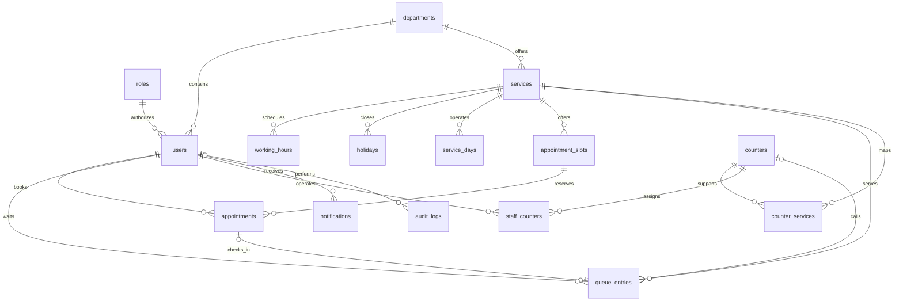

# Database design

PostgreSQL 17; Flyway owns schema changes, Hibernate validates mappings. Credentials are environment variables, never committed. For local development scripts/local-db.ps1 creates an isolated cluster on 127.0.0.1:55432, separate from an existing server. .local contains its password and data and is ignored. Production must use a least-privilege application account and a separate migration administrator.

The exact fields, foreign keys, nullability, checks and indexes are documented as executable SQL in app/src/main/resources/db/migration/V1__initial_schema.sql. Identity bigint IDs are internal; appointment references use UUIDs. Token display numbers are unique within service/day, never a global identifier. Queue URLs use internal IDs and enforce ownership.

Partial unique indexes enforce one active queue entry per student/service/day, one active appointment per student/service/day, and one CALLED/SERVING entry per counter. Unique appointment_id prevents double check-in. Date/status indexes support queue selection and history.

For this V1, business writes serialize through a PostgreSQL transaction-scoped advisory lock before reading mutable state. This simple single-instance/database-wide ordering provides predictable capacity and queue claims across app instances; throughput optimization can later replace it with consistently ordered row locks. Constraints remain a second line of defense. Reads remain concurrent. Integration tests must use PostgreSQL, including simultaneous requests; H2 is not used.

Times are stored as timestamptz; service days and working hours are interpreted in Asia/Kolkata. Original queue join time and latest enqueue time are separate so requeue does not rewrite history. Notifications and audits are written in the same transaction as the business update. No production/demo data is copied into the test database.
